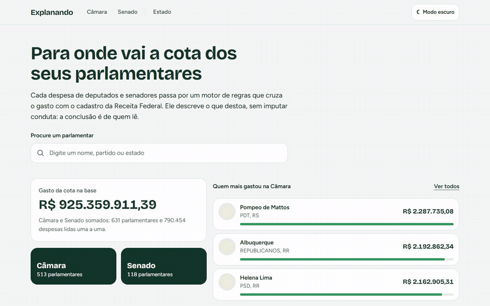
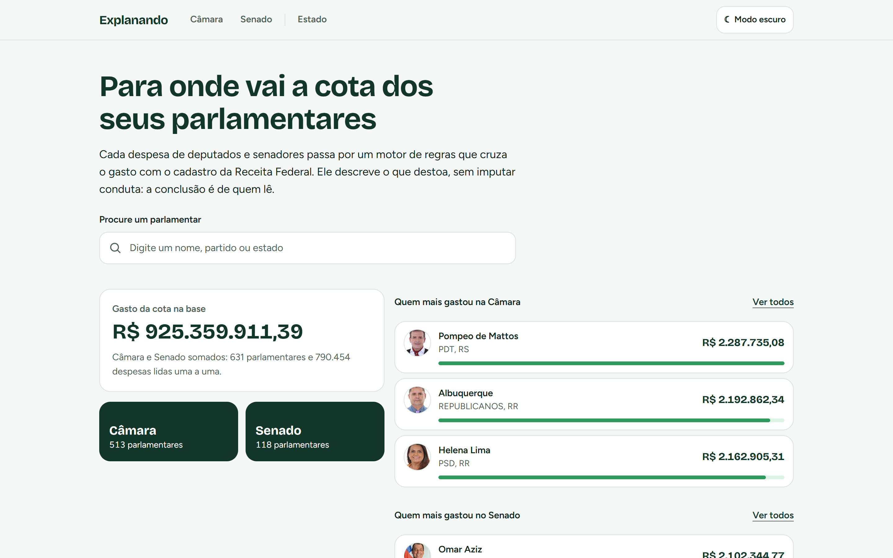
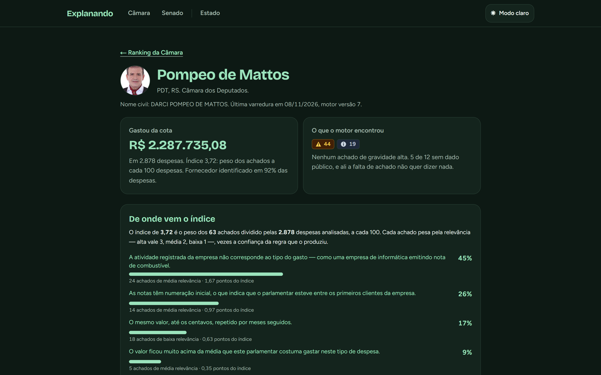
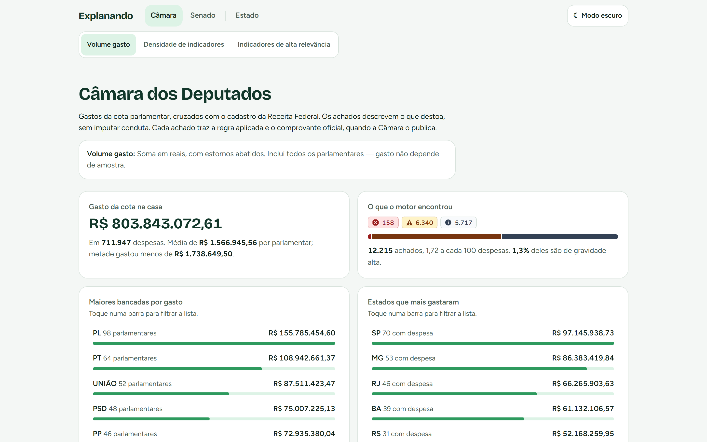
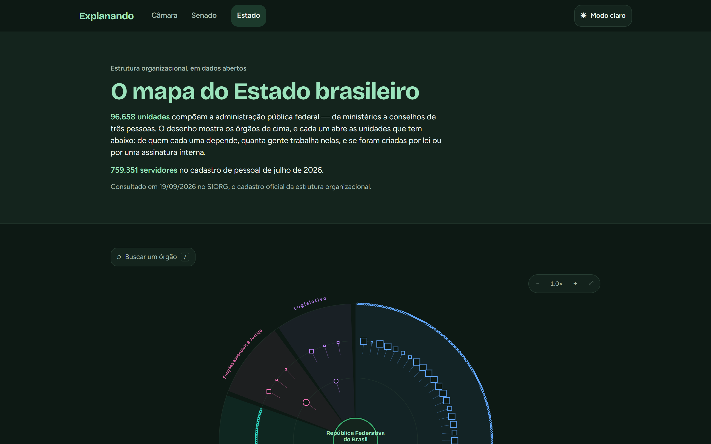

# Explanando

Explanando lê cada despesa da cota parlamentar de deputados e senadores e cruza o gasto com o
cadastro da Receita Federal. Um motor de regras determinísticas aponta o que destoa: empresa
cuja atividade não bate com o que vendeu, CNPJ irregular na data da nota, MEI acima do teto,
o mesmo valor repetido mês após mês. Ele descreve o que encontrou e não imputa conduta a
ninguém. A conclusão fica com quem lê.

> **Projeto encerrado em novembro de 2026.** O site não está no ar e não vai voltar. Este
> repositório é a versão final, aberta como portfólio da [Lotus Tecnologia](https://github.com/Lotus-Tecnologia).
> Os dados são de agosto de 2026 e não são atualizados. A história do projeto, inclusive o
> porquê do fim, está no [post-mortem](docs/post-mortem.md).



| | |
|---|---|
|  |  |
|  |  |

Mais telas, em claro, escuro e celular, em [`docs/imagens`](docs/imagens).

## Os números da base final

- 631 parlamentares: 513 deputados e 118 senadores, mandatos de 2023 a 2026.
- 790 mil despesas, R$ 925 milhões em cota.
- 14.650 achados no motor versão 7.
- O grafo do Poder Executivo federal (SIORG), com mais de cem mil ligações, e o quadro de
  pessoal mês a mês (Portal da Transparência).

## O motor

São 12 regras. Cada uma declara de qual dado externo depende. Quando esse dado falta, a
regra se abstém e a interface diz isso, em vez de mostrar zero
([ADR-0007](docs/decisoes/ADR-0007-postura-permissiva-do-motor.md)).

| Regra | O que aponta |
|---|---|
| `REG_KYB_001` | Atividade registrada da empresa incompatível com o tipo do gasto |
| `REG_KYB_002` | Nota emitida com a empresa já em situação irregular na Receita |
| `REG_KYB_003` | Empresa recém-aberta recebendo valor alto |
| `REG_KYB_004` | MEI acima do teto anual da categoria |
| `REG_KYB_005` | Numeração inicial de nota: o parlamentar entre os primeiros clientes |
| `REG_TX_001` | Várias notas do mesmo fornecedor no mesmo mês |
| `REG_TX_002` | Gasto do mês perto do limite da cota do estado |
| `REG_TX_003` | O mesmo valor, até os centavos, por meses seguidos |
| `REG_TX_004` | Valor muito acima da média do próprio parlamentar naquele tipo de despesa |
| `REG_GEO_002` | Gasto presencial fora do estado do parlamentar e fora de Brasília |
| `REG_GEO_003` | Alimentação ou hospedagem expressiva durante o recesso |
| `REG_NET_001` | Sócio da empresa paga com nome e CPF compatíveis com doador da campanha |
| `REG_NET_004` | Empresa recém-aberta concentrando pagamentos de vários parlamentares do mesmo partido |

Há dois números por parlamentar, e eles não se misturam
([ADR-0009](docs/decisoes/ADR-0009-dois-numeros-nao-um.md)): o volume gasto, em reais, e o
índice, que é o peso dos achados a cada 100 despesas, com piso amostral. O vermelho fica
reservado para gravidade alta, e a forma do selo acompanha a cor
([ADR-0013](docs/decisoes/ADR-0013-identidade-visual-e-taxonomia-de-risco.md)).

## Arquitetura

```
 Câmara · Senado · BrasilAPI · TSE · SIORG · Portal da Transparência
                              │
                        Worker (.NET)  ── coleta, motor de regras, consolidação
                              │
                        PostgreSQL 17
                              │
                        API (.NET, só leitura, cache e limite de taxa)
                              │
                        Next.js 16 (React 19, Tailwind 4)
```

O backend segue Clean Architecture em cinco projetos (Domain, Application, Infrastructure,
Api, Worker). A regra de dependência entre as camadas é verificada por teste, não por revisão
([ADR-0006](docs/decisoes/ADR-0006-arquitetura-verificada-por-teste.md)). As 21 decisões de
arquitetura estão em [`docs/decisoes`](docs/decisoes/README.md), e o diário de cada etapa em
[`docs/registro`](docs/registro/README.md).

## Testes

O projeto foi escrito com TDD ([ADR-0005](docs/decisoes/ADR-0005-tdd-e-niveis-de-teste.md)).
São 1.112 testes no backend (domínio, aplicação, integração com Postgres real via
Testcontainers, ponta a ponta e arquitetura) e 344 no frontend (Vitest e Testing Library).
Um dos testes de arquitetura percorre todos os arquivos versionados e falha se encontrar um
CPF válido fora de uma lista de CPFs sintéticos.

```bash
dotnet test backend/Explanando.slnx
```

```bash
cd frontend && npm ci && npm test
```

Os testes de integração precisam do Docker de pé.

## Como rodar localmente

Pré-requisitos: .NET SDK 10, Node 22 ou mais novo e Docker.

1. Suba o banco:

   ```bash
   docker compose up -d
   ```

2. Crie o esquema e colete os dados. A coleta completa leva horas, porque as fontes públicas
   têm limite de taxa; dá para começar por um mês só:

   ```bash
   cd backend && dotnet run --project src/Explanando.Worker -- coletar
   ```

   ```bash
   cd backend && dotnet run --project src/Explanando.Worker -- varrer
   ```

   O worker também aceita `coletar-senado`, `coletar-estado`, `coletar-pessoal` e
   `ciclo-mensal`.

3. Suba a API na porta 5199:

   ```bash
   cd backend && ASPNETCORE_URLS=http://localhost:5199 RateLimit__ChaveInterna=local dotnet run --project src/Explanando.Api
   ```

4. Suba o site:

   ```bash
   cd frontend && EXPLANANDO_CHAVE_INTERNA=local npm run dev
   ```

O pacote de produção numa VPS só (Postgres, API, site e túnel da Cloudflare em Docker
Compose) está em [`deploy/`](deploy), com o roteiro em [`docs/desdobramento.md`](docs/desdobramento.md).

## Dados pessoais

Tudo o que o Explanando mostra vem de fonte pública. Mesmo assim, o CPF de fornecedor pessoa
física é mascarado na ingestão, e as fixtures do repositório usam CPFs sintéticos e nomes
fictícios.

## Licença

[MIT](LICENSE).
